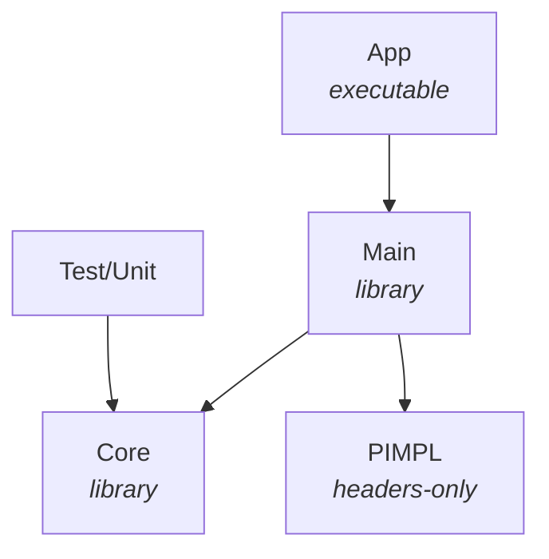

# Code2ERD

Entity-relationship diagrams in Chen notation from text, on Qt/C++: describe the entities, their attributes and
the relationships on the left, see the diagram on the right.

```
Entity Student {
  student_id [key]
  name { first, last }
  phone [multivalued]
  age [derived]
}

Entity Course { code [key], title }

Relationship Enrolls {
  Student (0, N)
  Course (1, N) [total]
  grade
}
```

- live diagram while typing; on errors the last valid diagram stays and the errors are underlined
  in the text, listed under it and shown in the gutter;
- entities and weak entities, relationships and identifying relationships, key, partial key, multivalued,
  derived and composite attributes, `1:N` or `(min, max)` cardinalities, total participation, roles,
  recursive and n-ary relationships, colors and notes;
- automatic layout: connected shapes close together, the attributes around their owner away from the lines;
  shapes keep their places when the text changes, also when something is renamed;
- draggable shapes (the attributes go along with their entity), undo of moves, zoom and pan,
  hover highlighting, click on a shape to jump to its definition, the cursor in the text selects the shape;
- export to PNG, SVG, PDF and the clipboard;
- light and dark themes.

The text is saved as `name.erd`; the positions of the shapes go to `name.layout.json` next to it.
The language is described in Help > ERD Language Reference (F1) and in
[Main/Resources/reference.html](Main/Resources/reference.html).

## Requirements

- Qt 5.15 with the modules `core`, `gui`, `widgets`, `svg`, `testlib`;
- qmake;
- C++17.

```
sudo apt install g++ build-essential qtbase5-dev qtbase5-dev-tools qt5-qmake libqt5svg5-dev
```

## Project structure



| Directory | Purpose |
| --- | --- |
| `App` | Entry point: `Code2ERD [file.erd]` |
| `Core/DTO` | Diagram model: entities, relationships, participants, attributes |
| `Core/Erd` | Lexer and parser of the ERD language with error recovery |
| `Core/Layout` | Shape positions, their JSON file, automatic layout |
| `Main/Diagram` | Graphics scene, view, shapes and lines of the Chen diagram |
| `Main/Editor` | ERD editor, syntax highlighting, find and replace |
| `Main/Export` | PNG, SVG and PDF rendering |
| `Main/Resources` | Example diagram, language reference, icons |
| `Test/Unit` | Unit tests of the parser, the layout and its file |

## Build

```
cd path/to/Code2ERD
mkdir -p build/Desktop-Debug
cd build/Desktop-Debug/
qmake ../../Code2ERD.pro -spec linux-g++ CONFIG+=debug
make -j8
../../v/bin/Code2ERD
```

All libraries, the application and the tests are built into `v/bin`.

## Tests

```
make check
```
